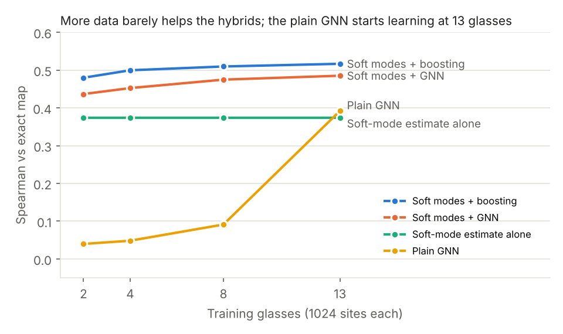
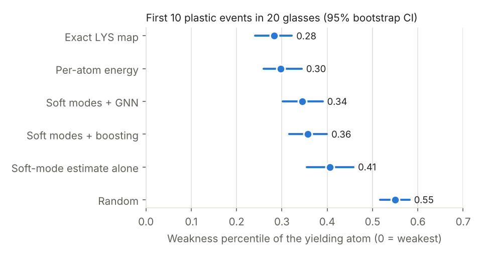
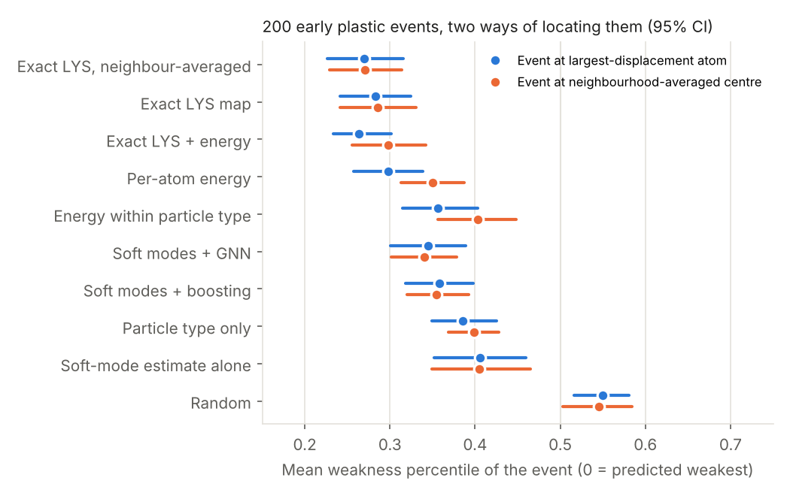

# Cutting the compute time of local-yield-stress maps in disordered solids

*Analysis of Bamer et al. (2023) and Loiodice et al. (2026), with a working prototype in `src/`
and every number below backed by a file in `results/`.*

## 1. Summary

The review by Bamer, Ebrahem, Markert and Stamm (RWTH Aachen) names the open
computational problem directly. The **local yield stress (LYS) method** of Patinet et al. is
the best available predictor of where a glass will yield. It needs a full set of local
athermal quasistatic (AQS) simulations at every scanning point and every loading direction,
which the authors call "cumbersome" and "challenging in terms of computational effort"
(Sect. 11.1–11.2). They ask for surrogate or reduced-order models (Sect. 11.3). The
reference paper (GFF-MAP, Loiodice et al.) shows the same pattern at the grain scale:
graph neural networks replace crystal-plasticity runs of about 6 h with predictions taking
under a minute, accepting lower accuracy on extreme quantities in exchange for fast screening.

This repository reproduces the 2D binary Lennard-Jones glass and the LYS scan from the review,
then tests three levels of acceleration on the same samples:

| Method | Wall time per 1024-site map (6 directions, 4 CPU cores) | Agreement with the exact map |
|---|---|---|
| Baseline LYS scan (fixed Δγ = 1e-4) | ≈ 6300 s (extrapolated from 48 sites) | reference |
| **Adaptive certified stepping**, exact setting | ≈ 770 s (**8.2×**) | 288/288 τ_c within 1e-3 |
| **Adaptive certified stepping**, fast setting (round-1 dataset) | 453 s (**13.4×**) | 287/288 τ_c within 1e-3; weakest direction 48/48 |
| **Adaptive stepping + f_max < 1e-6** (round-2 dataset) | 333 s (**18–19×**) | 288/288 τ_c within 1e-3 |
| **Soft-mode reduced-order estimate**, no learning | 4.5 s (**≈ 1400×**) | Spearman 0.24 (all), 0.38 (weakest direction) |
| **Soft modes + gradient boosting** | 4.5 s | Spearman 0.41 (all), 0.48 (weakest direction) |
| **Soft modes + GNN** | 4.6 s | Spearman 0.43 (all), 0.47 (weakest direction) |
| GNN on raw atomic structure only | 0.1 s | Spearman −0.08 (no skill) |

*In the accuracy panel, the adaptive rows show agreement with the baseline τ_c values, not a
Spearman correlation.*

Three findings:

1. **Adaptive certified stepping is a free, exact speed-up.** Coarse strain steps on the elastic
   branch use a secant predictor and are accepted only if they pass an elasticity check.
   Instabilities are always certified on the same fine Δγ grid as the baseline. The result
   is 8–13× less work and identical yield stresses in this test (Sect. 4.1). Every AQS or LYS
   code, including the review's in-house code, can adopt it.
2. **A GNN trained on raw structure from a small dataset fails.** With five training glasses
   (5120 sites), an edge-conditioned GNN reached zero rank correlation on held-out glasses.
   The LYS field is learnable in principle (neighbouring sites correlate at 0.75–0.83), but not
   from this little data without physical priors. This matches the GFF-MAP observation that
   the more localised and extreme a quantity, the harder it is to learn (Sect. 3).
3. **Physics-informed features fix it.** The cluster Hessian's soft modes, with a cubic
   saddle-node estimate, cost ~100× less than even the adaptive scan. Fed to gradient boosting
   or a GNN, they give rank correlations of 0.41–0.48. They recover ≈ 92% of the truly weakest
   10% of sites inside the predicted weakest 50% (Sect. 4.3). That supports a
   **screen-then-verify** workflow: rank all sites cheaply, then run the exact adaptive LYS
   only where it matters.

**Round-2 update (20 glasses, 200 plastic events; Sect. 4.5).** Loosening the minimiser
tolerance to f_max < 1e-6 lifts the exact speed-up to **18×**, with 288/288 yield stresses still
matching. More training data barely moves the physics-informed surrogates (Spearman ≈ 0.49 on the
weakest direction), and screening the weakest half of the sites saves only 2× at 89% recall.
A raw-structure GNN starts learning only beyond about 8 glasses. On real plastic events, the
exact LYS map is the best predictor.

**Round-3 update (Sect. 4.6 and 6).** The apparent energy result was mostly an artefact: the
event locator favours small particles, which have higher energy. With type controlled, energy is
no better than the soft-mode surrogates, while the exact LYS map stays the best predictor under
every control. A review of 48 papers (Sect. 6, `LITERATURE.md`) found no published adaptive-step
AQS scheme, so the 18× exact speed-up appears to be new. It also shows our data needs are one to
two orders of magnitude below those of prior ML studies.

## 2. What the main paper says about cost (Bamer et al. 2023)

*Molecular Mechanics of Disordered Solids*, Arch. Comput. Methods Eng. 30:2105–2180,
doi:10.1007/s11831-022-09861-1.

* **Model systems** (Sect. 8): a 2D binary Lennard-Jones glass (Falk–Langer/Lançon type, σ_SS = 2 sin(π/10),
  σ_LL = 2 sin(π/5), σ_SL = 1, N_L/N_S = (1+√5)/4), bulk silica (Stillinger–Weber/BKS),
  and a 2D network silica made by Monte Carlo bond switching.
* **Deformation** (Sect. 9): AQS, i.e. affine strain increments, each followed by full energy
  minimisation (steepest descent / Polak–Ribière CG, Sect. 7). Plastic events show up as
  stress drops. Near an event the lowest Hessian eigenvalue vanishes as a square root of the
  remaining strain, a saddle-node bifurcation (Eq. 146; Maloney & Lemaître 2006).
* **Prediction of shear transformation zones** (Sect. 9.3): structural indicators (free volume,
  flexibility volume), linear indicators (soft modes), nonlinear indicators (LYS, the
  activation-relaxation technique) and machine learning (softness, Fan et al.). The review
  concludes that **the LYS method has the highest predictive power**, but each grid point
  needs a set of AQS runs over orientations α ∈ [0°, 180°).
* **Stated research gaps** (Sect. 11): (i) the cost of LYS scanning; surrogate models
  "may prove to be of great added value". (ii) LYS has never been applied to network glasses.
  (iii) No reduced-order models exist for disordered solids, although the response near
  catastrophes is dominated by a few soft modes, which "opens up promising perspectives for
  transformations into low-order subspaces". (iv) Physics-informed learning (residual forces
  as an extra loss) is suggested.

**Where the time goes.** In an LYS scan the cost is
(sites) × (directions) × (strain steps to first instability) × (minimiser iterations per step) × (force-call cost).
The first two factors are set by the science. The last is O(N_cluster) with neighbour lists.
The middle two are where almost all of the waste is. With Δγ = 1e-4 and a typical local
yield strain of 0.03–0.12, each direction takes 300–1200 minimisations, almost all on smooth
elastic branches.

## 3. What the reference paper contributes (Loiodice et al. 2026)

*Grain-level micromechanical modeling and assessment of fatigue-critical pores using graph
neural networks*, npj Comput. Mater. 12:275, doi:10.1038/s41524-026-02148-0.

* The problem has the same shape at a different scale: an expensive local-response solver (EVP-FFT crystal
  plasticity, about 6 h per microstructure) is used to locate hotspots (the grain-maximum accumulated plastic
  strain energy density w_P,max, a crack-initiation indicator).
* Surrogate: GMMConv GNN (Monti et al. 2017) on a grain graph. Node features are orientation
  quaternions, size and shape; edge features are the distance vector (most important,
  especially its loading-axis component), shared area and misorientation. Inference takes under a minute.
* Accuracy falls with how localised the target is: σ_ZZ,avg R² = 0.909 (ρ = 0.951),
  σ_ZZ,max and w_P,avg in between, and w_P,max R² = 0.471 (ρ = 0.749). The authors therefore use
  **rank** (Spearman) rather than R² for hotspot screening.
* Regression followed by post-processing (find the maximum, check whether it is next to the pore)
  beats a direct classifier (F1 63.2% vs 53.3%; recall about 80% for both). Safety-oriented
  screening values recall over precision.
* Data scale: 2480 CP simulations (about 2 M grains) with careful feature engineering.

**Lessons carried over.** (a) Judge surrogates by ranking and recall of the weakest sites,
not by R². (b) Predict the field, then post-process it. (c) Relative-position edge features
matter. (d) A small dataset needs good physical features. The last lesson is the one the
experiments here confirm most strongly: with 5 glasses instead of about 2000 microstructures, the raw-structure
GNN learns nothing, and adding soft-mode features makes it work.

## 4. Prototype and results

Code: `src/lysgnn/sim.py` (numba kernels), `src/lysgnn/glass.py` (drivers),
`src/lysgnn/gnn.py` (GNN), `src/scripts/*` (experiments). See `src/README.md` to reproduce.

**System.** 2D binary LJ glass (Falk & Langer 1998; Bamer Sect. 8.1, Eqs. 92–94), with
ε_SL = 1, ε_SS = ε_LL = 1/2, a shifted-force cutoff at 2.5σ_ab, N = 1024, number density 1.0
(L = 32, residual pressure 0.3–0.5). Glasses are made by a melt at T = 1.0 (10⁴ MD steps),
a linear quench to T = 0.05 (2×10⁴ steps), then FIRE minimisation to |F|max < 1e-10.

**LYS scan** (Patinet et al. 2016; Barbot et al. 2018). The free disc has radius R = 5, inside a
frozen shell of thickness r_c,max = 2.94. Simple shear runs along θ ∈ {0°, 30°, …, 150°}, which
covers both shear signs because θ and θ + 180° are identical. τ_c is the resolved shear stress of
the free region just before its first instability; Δτ_c = τ_c − τ_0. The minimiser is FIRE
(Bitzek et al. 2006), compiled together with the loading loop so that a strain step has no
interpreter overhead. The scan is parallel over sites.

### 4.1 Adaptive certified stepping (exact acceleration)

Algorithm (`lys_direction`, `mode=1`):

1. Take a coarse step Δγ ≤ Δγ_coarse. The trial positions are the affine move plus a **secant
   predictor** of the non-affine motion, estimated from the last accepted step. This is a
   finite-difference version of the linear-response update in Eq. 135 of the review.
2. Minimise. Accept the step only if it looks purely elastic: the stress rose by at least a
   fraction `slope_frac` of the last elastic slope, and no atom moved more than 0.02 from the
   predictor.
3. Otherwise restore the last accepted state and halve Δγ. At Δγ = 1e-4, the baseline's own
   test (any stress drop, or a jump > 0.1) decides. Instabilities are therefore always
   certified on the baseline grid.
4. After an accepted step, double Δγ again (capped at Δγ_coarse).

Benchmark (`results/benchmark_lys.json`: 48 random sites × 6 directions = 288 runs on one
glass; baseline 295.5 s, 5.13×10⁷ FIRE iterations):

| Δγ_coarse | slope_frac | speed-up (wall) | τ_c within 1e-3 of baseline | weakest direction exact |
|---|---|---|---|---|
| 1e-3 | 0.8 | 8.2× | 100% | 100% |
| 2e-3 | 0.8 | 11.0× | 99.7% | 100% |
| 4e-3 | 0.8 | 13.4× | 99.7% | 100% |
| 2e-3 | 0.5 | 13.5× | 99.3% | 97.9% |
| 4e-3 | 0.5 | 17.4× | 98.6% | 97.9% |

The looser `slope_frac = 0.5` occasionally steps over a small precursor event and reports a later,
larger one. That is why the elasticity check matters, and why 0.8 is the default. The wall-time
and iteration speed-ups agree to within 3%, so the gain is algorithmic, not an artefact of timing.

### 4.2 GNN on raw structure (negative result)

The model is `LYSNet`: 6 edge-conditioned message-passing layers (NNConv-style gates; Gilmer et al. 2017) on the
atom graph (edges within r < 2). Edge features are a radial basis, angular harmonics cos/sin(mφ) for m ≤ 4,
and the pair type. It predicts Δτ_c for all 6 directions. Rotating a sample by 30° shifts the
direction index by one; this was verified numerically on rotated clusters to 4 decimals and is used as
exact data augmentation. Trained on glasses 10–14, validated on 15, tested on 16–17
(`results/gnn.json`): the validation MSE never fell below the target variance (0.136 vs ≈ 0.12),
and test Spearman was −0.08 (all) and 0.11 (weakest direction).

### 4.3 Soft-mode reduced-order model and hybrid surrogates

For each site, the dense Hessian of the frozen-boundary cluster (about 160 degrees of freedom) is
diagonalised. For each of the 12 softest modes φ_k (eigenvalue λ_k) the code computes the third
derivative κ_k along the mode (3 force calls) and the generalised loading force
h_k(θ) = φ_k · ∂F/∂γ (2 force calls per direction). A cubic expansion
E(q) = λq²/2 + κq³/6 − γ h q loses stability at the saddle-node

  γ_k(θ) = −λ_k² / (2 κ_k h_k(θ)), when positive,

which is the one-mode version of the nonlinear-mode yield predictions discussed in Bamer
Sect. 9.3 (Xu et al.) and of the reduced-order idea in Sect. 11.3. Cost: 4.5 s per 1024-site map,
compared with 453 s for the fast adaptive scan and ≈ 6300 s for the baseline.

| Predictor (test glasses 16, 17) | Spearman, all sites × directions | Spearman, weakest direction | Spearman, θ = 0 |
|---|---|---|---|
| Soft-mode γ_min, no learning | 0.24 | 0.38 | 0.14 |
| Per-atom potential energy | 0.07 | 0.10 | n/a |
| Soft-mode features + gradient boosting | 0.41 | 0.48 | 0.31 |
| Soft-mode features + GNN (`--softdir`) | 0.43 | 0.47 | 0.37 |

**Screening** (`results/screening.json`): the share of the truly weakest 10% of sites (weakest
direction) that fall inside the predicted weakest fraction f:

| f | 10% | 20% | 30% | 50% |
|---|---|---|---|---|
| Soft modes + GNN | 0.34 | 0.58 | 0.71 | **0.92** |
| Soft modes + boosting | 0.32 | 0.58 | 0.72 | 0.91 |
| GNN on raw structure | 0.15 | 0.27 | 0.38 | 0.57 |

So running the exact adaptive scan on only the predicted weakest half of the sites recovers about
92% of the weakest sites. Combined with the 13× adaptive speed-up, that gives ≈ 26× overall
against the baseline. The soft-mode ranking itself is essentially free.

The surrogate reproduces the large-scale weak and strong regions but compresses the dynamic range,
the same "regression to the mean on extremes" that GFF-MAP reports for w_P,max.

### 4.4 Link to actual plastic events

The two test glasses were also sheared globally (AQS, Δγ = 1e-4 to γ = 0.1; 17 and 22 stress drops),
and each event was located at the atom with the largest non-affine displacement. For the first 10
events, the mean percentile rank of the event atom in each predictor's θ = 0 field (0 = weakest)
was: exact LYS 0.20 / 0.29; soft-mode GNN 0.42 / 0.42; soft-mode boosting 0.36 / 0.40;
potential energy 0.30 / 0.18; random 0.63 / 0.43. With 10 events per glass these numbers are too
noisy to rank the surrogates against each other. They do confirm that the exact LYS field points
at the early events, as reported by Patinet et al. (2016) and Barbot et al. (2018). A proper
test needs many more glasses and events (Sect. 5).

### 4.5 Round 2: tolerances, more data, and a proper event test

Round 2 grew the dataset from 8 to 20 glasses (20 480 sites × 6 directions, all with exact
LYS maps) and sheared every glass globally to collect 200 early plastic events. Code:
`scripts/benchmark_lys_more.py`, `scripts/round2_study.py`, `scripts/round2_figures.py`;
numbers in `results/benchmark_lys_more.json`, `results/benchmark_ftol.json`, `results/round2.json`.

**Step size and minimiser tolerance.** Increasing the coarse step beyond Δγ = 4e-3 gains nothing,
because the speed-up plateaus at about 13×. The minimiser tolerance helps instead. The baseline
relaxes to f_max < 1e-9, but the adaptive scan with `slope_frac = 0.9` and f_max < 1e-6 still
reproduces all 288 baseline τ_c values within 1e-3, and on the weakest direction 48/48. It runs
**18.1×** faster than the original baseline (16.3 s against 295.5 s on 48 sites). For a fair
comparison, the baseline itself at f_max < 1e-6 takes 170 s, so stepping alone contributes
10.4× and the looser tolerance the rest. Over the 12 new glasses a full 1024-site, 6-direction
map now takes 333 s on 4 cores, against ≈ 6300 s for the baseline.

**Data scaling** (fixed test set of 6 glasses, training on 2–13 glasses):

The physics-informed surrogates are already near their ceiling at two glasses. Soft modes with
boosting move from 0.48 to 0.52 in Spearman on the weakest direction, and soft modes with a GNN
from 0.44 to 0.49. The GNN on raw structure, which had no skill in round 1, starts to learn
between 8 and 13 glasses (0.09 to 0.39). This matches the GFF-MAP observation that raw-structure
models need large datasets. A raw-structure model is the only one here still clearly improving
with data, so it is the one worth scaling up (Sect. 5).

**Cross-validated screening** (5 folds over all 20 glasses):

| Weakness field | Spearman (all) | Spearman (weakest direction) | Recall of weakest 10% in predicted 10% / 30% / 50% |
|---|---|---|---|
| Soft modes + boosting | 0.42 | 0.49 | 0.42 / 0.72 / 0.89 |
| Soft modes + GNN | 0.42 | 0.48 | 0.35 / 0.69 / 0.89 |
| Soft-mode estimate alone | 0.22 | 0.38 | 0.43 / 0.76 / 0.90 |
| Per-atom potential energy | 0.04 | 0.06 | 0.13 / 0.34 / 0.54 |

The learned models improve the overall ranking, but the raw soft-mode estimate is as good or
better at finding the weakest tail, which is what screening needs. With the exact scan at 333 s
per map, verifying the predicted weakest 50% recovers 89% of the weakest 10% in 171 s. That is a
**2× saving**, much smaller than the stepping gain, and it costs about one weak site in ten.

**Plastic events** (first 10 events in each of 20 glasses, 200 events, θ = 0 field, 95%
bootstrap intervals over glasses):

The exact LYS map places the yielding atom at a mean percentile of 0.28 (0.24–0.32), and 33% of
the early events fall in its weakest 10% of sites (random: 9%). The soft-mode surrogates sit
between the exact map and random (0.34–0.41). This is the expected order and confirms the
round-1 trend with statistically separated intervals.

The surprise was per-atom potential energy. It has no rank correlation with the LYS map (0.04),
yet it appeared to predict the yielding atom almost as well as the exact map (0.30, 63% of events
in its weakest 30% against 64% for LYS). Round 3 (Sect. 4.6) shows this was mostly an artefact
of the event locator, which favours small, high-energy particles.

### 4.6 Round 3: does per-atom energy really predict plastic events?

Round 2 found that per-atom potential energy placed the yielding atom almost as well as the exact
LYS map, although the two fields are uncorrelated (Sect. 4.5). Round 3 tests whether this is real
or an artefact of how events are located. The global AQS shear of all 20 glasses was re-run up
to the 10th plastic event, this time keeping the full non-affine displacement field of every event
(`scripts/round3_events.py`, `results/round3_events.json`, fields in `results/events/`).

**The event locator is biased by particle type.** Small particles make up 55% of the glass but
83% of the "largest non-affine displacement" atoms. Small particles also sit at higher energy
(mean −1.89 against −2.51 for large ones), so a raw energy ranking partly just selects small
particles. Ranking by particle type alone, with no structure at all, already scores 0.39
(0.35–0.43) against 0.55 for random.

**Once type is removed, energy is an ordinary predictor.** Two controls were applied:
standardising energy within each particle type, and locating each event at the maximum of the
neighbourhood-averaged displacement field (radius 1.5), which agrees with the single-atom locator
in only 29% of events and lies 1.1 σ away on average. Under either control, energy falls from
0.30 to 0.35–0.40, level with the soft-mode surrogates. The exact LYS map is unaffected: it stays
at 0.28–0.29 under every locator and within each particle type.

| Predictor (θ = 0 field) | Atom locator | Centre locator | Within particle type | Events in weakest 10% (atom) |
|---|---|---|---|---|
| Exact LYS, neighbour-averaged | **0.27** (0.23–0.32) | **0.27** (0.23–0.31) | **0.27** | 35% |
| Exact LYS map | 0.28 (0.24–0.32) | 0.29 (0.24–0.33) | 0.29 | 33% |
| Exact LYS + energy (rank sum) | 0.26 (0.23–0.30) | 0.30 (0.26–0.34) | 0.26 | 35% |
| Per-atom energy | 0.30 (0.26–0.34) | 0.35 (0.31–0.39) | 0.36 | 23% |
| Energy standardised within type | 0.36 (0.31–0.40) | 0.40 (0.36–0.45) | 0.36 | 21% |
| Soft modes + GNN | 0.35 (0.30–0.39) | 0.34 (0.30–0.38) | 0.35 | 20% |
| Soft modes + boosting | 0.36 (0.32–0.40) | 0.36 (0.32–0.39) | 0.36 | 20% |
| Particle type only | 0.39 (0.35–0.43) | 0.40 (0.37–0.43) | 0.55 | 10% |
| Soft-mode estimate alone | 0.41 (0.35–0.46) | 0.41 (0.35–0.47) | 0.41 | 18% |
| Random | 0.55 (0.52–0.58) | 0.55 (0.50–0.58) | 0.55 | 9% |

*Mean weakness percentile of the event (0 = predicted weakest), with 95% bootstrap intervals over
glasses; 200 events in 20 glasses.*

Three conclusions follow.

1. **The round-2 energy result was mostly a locator artefact.** It should not be used to argue
   that energy is as good as LYS. This agrees with the benchmark of Richard et al. (2020), where
   local energy is a weak indicator of the first plastic event, and with Widmer-Cooper and
   Harrowell (2006), who found inherent-structure energy correlates poorly with dynamic propensity.
2. **Adding energy to LYS does not help robustly.** The rank sum gains 0.02 with the atom locator
   and loses 0.01 with the centre locator, both inside the intervals.
3. **Averaging the LYS map over neighbours helps slightly under every locator** (0.27 against
   0.28–0.29). An STZ involves several atoms, so the coarse-grained field is the better target for
   a surrogate. This matches Boattini et al. (2021), who found neighbourhood averaging to be the
   key ingredient for structure-based prediction.

A third locator was also tried: the weakest predicted site within radius 2 of the event centre.
It is not reported, because a random field already scores 0.08 under it (a minimum over about
13 sites), so it cannot separate the predictors.

### 4.7 Limits of this study

* 2D, a single quench protocol, N = 1024. Round 1 used 8 glasses (5 train, 1 validation, 2 test),
  and round 2 extends this to 20 glasses with 5-fold cross-validation (Sect. 4.5).
* The LYS scan uses 6 directions and simple shear only. Barbot et al. also analyse pure shear
  and finer angular grids.
* The soft-mode estimate uses the undeformed Hessian. Modes rotate and hybridise under load
  (Gendelman et al.; Bamer Sect. 9.3), which caps its accuracy for large yield strains.
* The adaptive method's guarantee is empirical (288/288 at the exact setting), not proven. An
  event smaller than the elasticity tolerance can in principle hide inside a coarse step.

## 5. Recommended changes for the project

In order of payoff per effort:

1. **Adopt adaptive certified stepping in every AQS/LYS code, with a looser minimiser tolerance**
   (exact, 18× here: Δγ_coarse = 4e-3, `slope_frac = 0.9`, f_max < 1e-6). The changes are local
   to the strain loop: a secant predictor, an elasticity check, and bisection to the original
   grid. Validate once per new material against the fixed-step baseline with
   `scripts/benchmark_lys.py`. This is by far the largest saving found in this study.
2. **Compile the whole minimise-and-load loop** (numba here; Julia already does this when written type-stably)
   and use FIRE instead of line-search CG (Bitzek et al. 2006; FIRE 2.0, Guénolé et al. 2020).
   The scan is embarrassingly parallel over sites, and each cluster has only about 200 atoms, so
   batching thousands of clusters on a GPU (JAX/CUDA) is the next order of magnitude.
3. **Screen-then-verify with the soft-mode estimate.** Rank all sites in seconds and run the exact
   scan only on the predicted weakest 50%. Round 2 shows this halves the cost at 89–90% recall of
   the weakest sites, and the plain soft-mode estimate does this as well as the learned models
   (Sect. 4.5). Use it when only the weak tail matters, not for full maps.
4. **Grow the dataset with the cheap exact scan, then train a symmetry-aware model.** The
   raw-structure GNN only starts learning between 8 and 13 glasses (Sect. 4.5), and the
   physics-feature models have plateaued, so data is now the bottleneck for learned models. τ_c(θ) is
   π-periodic, so predict its Fourier coefficients in 2θ with an E(2)-equivariant network
   (in the spirit of NequIP, Batzner et al. 2022). The symmetry is then exact rather than augmented,
   which should reduce the data the raw-structure model needs. Train on the neighbour-averaged LYS
   field, which predicts real events slightly better than the raw map (Sect. 4.6). When validating
   against plastic events, locate them by a neighbourhood-averaged displacement and check within
   each particle type, or the comparison is biased by particle size (Sect. 4.6). Bapst et al. (2020) showed GNNs can
   read glassy dynamics from static structure when data is plentiful.
5. **Active learning.** Use model uncertainty (ensembles) to choose which sites get the exact scan,
   mirroring how GFF-MAP uses multiple SEVMs per pore for robust, probabilistic screening.
6. **Physics-informed loss** (Bamer Sect. 11.3): penalise residual forces of the predicted
   relaxed cluster, or require consistency with the soft-mode bound γ_c ≤ γ_k.
7. **Extend to network glasses** (the 2D silica model of the review), where LYS has never been
   applied (Sect. 11.1). The adaptive scan and soft-mode features carry over unchanged; only the
   potential changes. Run under pressure as well as shear to capture the review's
   damage-versus-plasticity distinction.
8. **Feed the maps upward.** Fast LYS maps are exactly the input that atomistically calibrated
   elasto-plastic models need (Castellanos et al., review refs. 206–207). This is the multiscale
   route of Sect. 11.2.

## 6. Related literature and where this work sits

The full annotated list of 48 verified papers is in [LITERATURE.md](LITERATURE.md). This section
places the results above within that literature.

**Structural indicators.** The reference benchmark is Richard et al. (2020). It compared about 20
indicators on 2D binary LJ glasses like ours and found that indicators built from the Hessian
(soft modes, nonlinear quasilocalised modes) and the residual plastic strength, which is the LYS
of Patinet et al. (2016) and Barbot et al. (2018), predict the first AQS events best. Purely
structural quantities such as local energy or free volume do poorly. Our ranking matches that
benchmark: exact LYS first, Hessian-based soft-mode surrogates second, local energy last once the
particle-type bias is removed (Sect. 4.6). LYS has since been extended to 3D, where Ruan et al.
(2022) found the best probe radius to be about 5σ and showed that the full yield surface is
anisotropic. Lerbinger et al. (2022) showed that LYS also predicts thermal relaxation in supercooled
liquids. Both results multiply the number of LYS calculations a study needs, which is why the cost
reductions here matter beyond athermal shear.

**Cheap physics proxies.** Our soft-mode saddle-node estimate belongs to a family going back to
Manning and Liu (2011), who showed that low-frequency modes locate soft spots, and Maloney and
Lacks (2006), who derived the δ^(3/2) barrier scaling near an instability that our extrapolation
relies on. Xu et al. (2018) predicted the triggering strain of individual STZs by following
minimum-energy paths, which is the closest precedent for our estimate. Nonlinear and
quasilocalised modes (Gartner and Lerner 2016; Kapteijns et al. 2020; Richard et al. 2021) avoid the
hybridisation with phonons that limits harmonic eigenvectors. Using them instead of harmonic modes
is the most promising way to raise the proxy above its current Spearman ≈ 0.4.

**Machine learning.** GNNs on raw positions work for glassy dynamics when data is plentiful
(Bapst et al. 2020, about 400 configurations of 4096 particles per state point). Simple models on
physically motivated, neighbourhood-averaged descriptors match them with far less data (Boattini
et al. 2021; GlassMLP, Jung et al. 2023, about 100 training structures). Our result follows the same
pattern. The physics-feature models are already at their ceiling with two glasses, and the
raw-structure GNN only begins to learn beyond about eight glasses of 1024 atoms, which is one to
two orders of magnitude less data than those studies used. The closest prior LYS surrogate is the
image model of Xiao et al. (2023), which predicts per-particle local yield stress to feed a
structuro-elastoplastic model of ductility. Fan and Ma (2021) predict orientation-dependent shear
susceptibility, the same angular structure as our six-direction LYS. Rotation-equivariant GNNs for
glasses (Pezzicoli et al. 2024) and equivariant interatomic potentials (NequIP, Batzner et al. 2022;
Allegro, Musaelian et al. 2023) report large gains in data efficiency, which supports recommendation 4.
For 2D silica, the network glass the review highlights, Font-Clos et al. (2022) trained a CNN on
about 720 samples to predict failure strain, and its attention maps tracked per-atom energy.
Energy may therefore matter more for failure of network glasses than for the first shear
transformation in LJ glasses, a distinction worth testing when the work moves to silica.

**Faster simulation.** FIRE (Bitzek et al. 2006) and FIRE 2.0 (Guénolé et al. 2020) are the
standard AQS minimisers, and JAX-MD (Schoenholz and Cubuk 2020), LAMMPS (Thompson et al. 2022) and
HOOMD-blue (Anderson et al. 2020) provide GPU paths. Saddle-search methods such as ART nouveau
(Barkema and Mousseau 1996; Malek and Mousseau 2000), the dimer method (Henkelman and Jónsson 1999)
and CI-NEB (Henkelman et al. 2000) find barriers without driving the system. We found no
published adaptive or event-driven strain-stepping scheme for AQS. Richard et al. (2020), for
example, still use a fixed Δγ = 10⁻⁵ "in order not to miss plastic events". The certified adaptive
stepping of Sect. 4.1 and 4.5 therefore appears to be a methodological contribution in its own
right, and it applies unchanged to every protocol above.

**Downstream use.** Elasto-plastic models consume exactly the local thresholds that LYS measures
(Nicolas et al. 2018). Fernández Castellanos et al. (2021, 2022) calibrated such models on LYS
maps of 2D LJ glasses and reproduced history-dependent plasticity. A fast, exact LYS scan is
therefore what makes atomistically informed EPMs practical at scale, which is the multiscale route
of Bamer Sect. 11.2.

**Active learning.** Query-by-committee active learning (Smith et al. 2018) and uncertainty-driven
adaptive sampling (Lookman et al. 2019) reach a given accuracy with a fraction of the labels.
With exact LYS at 333 s per glass and soft modes at 4 s, selecting which glasses or sites get the
exact scan is a natural next step (recommendation 5).

## 7. References

* Bamer F., Ebrahem F., Markert B., Stamm B. Molecular mechanics of disordered solids. *Arch. Comput. Methods Eng.* 30, 2105–2180 (2023).
* Loiodice L., Stopka K.S., Sun Y., Lin G., Sangid M.D. Grain-level micromechanical modeling and assessment of fatigue-critical pores using graph neural networks. *npj Comput. Mater.* 12, 275 (2026).
* Patinet S., Vandembroucq D., Falk M.L. Connecting local yield stresses with plastic activity in amorphous solids. *Phys. Rev. Lett.* 117, 045501 (2016).
* Barbot A., Lerbinger M., Hernandez-Garcia A., García-García R., Falk M.L., Vandembroucq D., Patinet S. Local yield stress statistics in model amorphous solids. *Phys. Rev. E* 97, 033001 (2018).
* Richard D. et al. Predicting plasticity in disordered solids from structural indicators. *Phys. Rev. Materials* 4, 113609 (2020).
* Falk M.L., Langer J.S. Dynamics of viscoplastic deformation in amorphous solids. *Phys. Rev. E* 57, 7192 (1998).
* Maloney C.E., Lemaître A. Amorphous systems in athermal, quasistatic shear. *Phys. Rev. E* 74, 016118 (2006).
* Manning M.L., Liu A.J. Vibrational modes identify soft spots in a sheared disordered packing. *Phys. Rev. Lett.* 107, 108302 (2011).
* Cubuk E.D. et al. Identifying structural flow defects in disordered solids using machine-learning methods. *Phys. Rev. Lett.* 114, 108001 (2015).
* Bapst V. et al. Unveiling the predictive power of static structure in glassy systems. *Nat. Phys.* 16, 448–454 (2020).
* Fan Z., Ma E. Predicting orientation-dependent plastic susceptibility from static structure in amorphous solids via deep learning. *Nat. Commun.* 12, 1506 (2021).
* Bitzek E., Koskinen P., Gähler F., Moseler M., Gumbsch P. Structural relaxation made simple. *Phys. Rev. Lett.* 97, 170201 (2006).
* Guénolé J. et al. Assessment and optimization of the fast inertial relaxation engine (FIRE) for energy minimization in atomistic simulations and its implementation in LAMMPS. *Comput. Mater. Sci.* 175, 109584 (2020).
* Gilmer J. et al. Neural message passing for quantum chemistry. *ICML* (2017), arXiv:1704.01212.
* Monti F. et al. Geometric deep learning on graphs and manifolds using mixture model CNNs. *CVPR* (2017), arXiv:1611.08402.
* Batzner S. et al. E(3)-equivariant graph neural networks for data-efficient and accurate interatomic potentials. *Nat. Commun.* 13, 2453 (2022).
* Ruan D., Patinet S., Falk M.L. Predicting plastic events and quantifying the local yield surface in 3D model glasses. *J. Mech. Phys. Solids* 158, 104671 (2022).
* Lerbinger M., Barbot A., Vandembroucq D., Patinet S. Relevance of shear transformations in the relaxation of supercooled liquids. *Phys. Rev. Lett.* 129, 195501 (2022).
* Maloney C.E., Lacks D.J. Energy barrier scalings in driven systems. *Phys. Rev. E* 73, 061106 (2006).
* Xu B., Falk M.L., Li J.F., Kong L.T. Predicting shear transformation events in metallic glasses. *Phys. Rev. Lett.* 120, 125503 (2018).
* Gartner L., Lerner E. Nonlinear modes disentangle glassy and Goldstone modes in structural glasses. *SciPost Phys.* 1, 016 (2016).
* Kapteijns G., Richard D., Lerner E. Nonlinear quasilocalized excitations in glasses. I. True representatives of soft spots. *Phys. Rev. E* 101, 032130 (2020).
* Richard D., Kapteijns G., Giannini J.A., Manning M.L., Lerner E. Simple and broadly applicable definition of shear transformation zones. *Phys. Rev. Lett.* 126, 015501 (2021).
* Widmer-Cooper A., Harrowell P. Predicting the long-time dynamic heterogeneity in a supercooled liquid on the basis of short-time heterogeneities. *Phys. Rev. Lett.* 96, 185701 (2006).
* Boattini E., Smallenburg F., Filion L. Averaging local structure to predict the dynamic propensity in supercooled liquids. *Phys. Rev. Lett.* 127, 088007 (2021).
* Jung G., Biroli G., Berthier L. Predicting dynamic heterogeneity in glass-forming liquids by physics-inspired machine learning. *Phys. Rev. Lett.* 130, 238202 (2023).
* Xiao H. et al. Identifying microscopic factors that influence ductility in disordered solids. *PNAS* 120, e2307552120 (2023).
* Pezzicoli F.S., Charpiat G., Landes F.P. Rotation-equivariant graph neural networks for learning glassy liquids representations. *SciPost Phys.* 16, 136 (2024).
* Musaelian A. et al. Learning local equivariant representations for large-scale atomistic dynamics. *Nat. Commun.* 14, 579 (2023).
* Font-Clos F. et al. Predicting the failure of two-dimensional silica glasses. *Nat. Commun.* 13, 2820 (2022).
* Schoenholz S.S., Cubuk E.D. JAX MD: A framework for differentiable physics. *NeurIPS* 33 (2020).
* Thompson A.P. et al. LAMMPS: a flexible simulation tool for particle-based materials modeling at the atomic, meso, and continuum scales. *Comput. Phys. Commun.* 271, 108171 (2022).
* Anderson J.A., Glaser J., Glotzer S.C. HOOMD-blue: A Python package for high-performance molecular dynamics and hard particle Monte Carlo simulations. *Comput. Mater. Sci.* 173, 109363 (2020).
* Barkema G.T., Mousseau N. Event-based relaxation of continuous disordered systems. *Phys. Rev. Lett.* 77, 4358 (1996).
* Malek R., Mousseau N. Dynamics of Lennard-Jones clusters: A characterization of the activation-relaxation technique. *Phys. Rev. E* 62, 7723 (2000).
* Henkelman G., Jónsson H. A dimer method for finding saddle points on high dimensional potential surfaces using only first derivatives. *J. Chem. Phys.* 111, 7010 (1999).
* Henkelman G., Uberuaga B.P., Jónsson H. A climbing image nudged elastic band method for finding saddle points and minimum energy paths. *J. Chem. Phys.* 113, 9901 (2000).
* Nicolas A., Ferrero E.E., Martens K., Barrat J.-L. Deformation and flow of amorphous solids: Insights from elastoplastic models. *Rev. Mod. Phys.* 90, 045006 (2018).
* Fernández Castellanos D., Roux S., Patinet S. Insights from the quantitative calibration of an elasto-plastic model from a Lennard-Jones atomic glass. *C. R. Physique* 22(S3), 135–162 (2021).
* Castellanos D.F., Roux S., Patinet S. History dependent plasticity of glass: A mapping between atomistic and elasto-plastic models. *Acta Mater.* 241, 118405 (2022).
* Smith J.S., Nebgen B., Lubbers N., Isayev O., Roitberg A.E. Less is more: Sampling chemical space with active learning. *J. Chem. Phys.* 148, 241733 (2018).
* Lookman T., Balachandran P.V., Xue D., Yuan R. Active learning in materials science with emphasis on adaptive sampling using uncertainties for targeted design. *npj Comput. Mater.* 5, 21 (2019).
