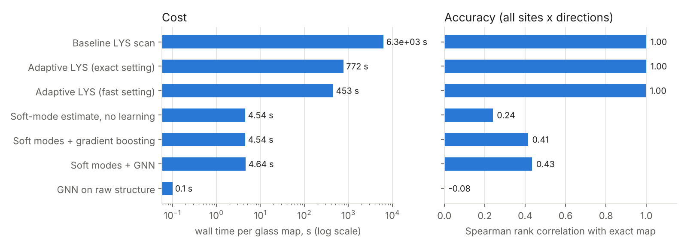
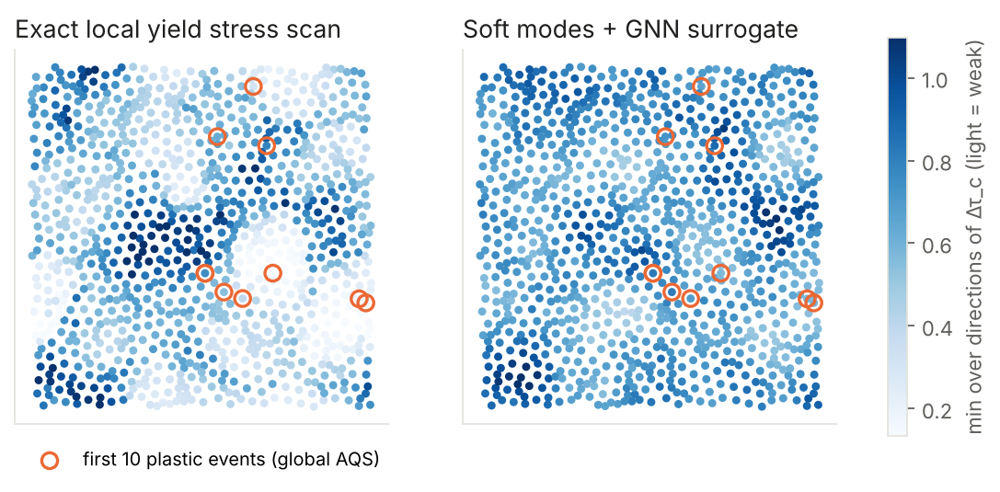

# Cutting the compute time of local-yield-stress maps in disordered solids

*Analysis of Bamer et al. (2023) and Loiodice et al. (2026), with a working prototype in `src/`
and every number below backed by a file in `results/`.*

## 1. Summary

The review by Bamer, Ebrahem, Markert and Stamm (RWTH Aachen) names the open
computational problem directly. The **local yield stress (LYS) method** of Patinet et al. is
the best available predictor of where a glass will yield. It needs a full set of local
athermal quasistatic (AQS) simulations at every scanning point and every loading direction,
which the authors call "cumbersome" and "challenging in terms of computational effort"
(Sect. 11.1–11.2). They ask for surrogate or reduced-order models (Sect. 11.3). The
reference paper (GFF-MAP, Loiodice et al.) shows the same pattern at the grain scale:
graph neural networks replace crystal-plasticity runs of about 6 h with predictions taking
under a minute, accepting lower accuracy on extreme quantities in exchange for fast screening.

This repository reproduces the 2D binary Lennard-Jones glass and the LYS scan from the review,
then tests three levels of acceleration on the same samples:

| Method | Wall time per 1024-site map (6 directions, 4 CPU cores) | Agreement with the exact map |
|---|---|---|
| Baseline LYS scan (fixed Δγ = 1e-4) | ≈ 6300 s (extrapolated from 48 sites) | reference |
| **Adaptive certified stepping**, exact setting | ≈ 770 s (**8.2×**) | 288/288 τ_c within 1e-3 |
| **Adaptive certified stepping**, fast setting (used for the dataset) | 453 s (**13.4×**) | 287/288 τ_c within 1e-3; weakest direction 48/48 |
| **Soft-mode reduced-order estimate**, no learning | 4.5 s (**≈ 1400×**) | Spearman 0.24 (all), 0.38 (weakest direction) |
| **Soft modes + gradient boosting** | 4.5 s | Spearman 0.41 (all), 0.48 (weakest direction) |
| **Soft modes + GNN** | 4.6 s | Spearman 0.43 (all), 0.47 (weakest direction) |
| GNN on raw atomic structure only | 0.1 s | Spearman −0.08 (no skill) |

*In the accuracy panel, the adaptive rows show agreement with the baseline τ_c values, not a
Spearman correlation.*

Three findings:

1. **Adaptive certified stepping is a free, exact speed-up.** Coarse strain steps on the elastic
   branch use a secant predictor and are accepted only if they pass an elasticity check.
   Instabilities are always certified on the same fine Δγ grid as the baseline. The result
   is 8–13× less work and identical yield stresses in this test (Sect. 4.1). Every AQS or LYS
   code, including the review's in-house code, can adopt it.
2. **A GNN trained on raw structure from a small dataset fails.** With five training glasses
   (5120 sites), an edge-conditioned GNN reached zero rank correlation on held-out glasses.
   The LYS field is learnable in principle (neighbouring sites correlate at 0.75–0.83), but not
   from this little data without physical priors. This matches the GFF-MAP observation that
   the more localised and extreme a quantity, the harder it is to learn (Sect. 3).
3. **Physics-informed features fix it.** The cluster Hessian's soft modes, with a cubic
   saddle-node estimate, cost ~100× less than even the adaptive scan. Fed to gradient boosting
   or a GNN, they give rank correlations of 0.41–0.48. They recover ≈ 92% of the truly weakest
   10% of sites inside the predicted weakest 50% (Sect. 4.3). That supports a
   **screen-then-verify** workflow: rank all sites cheaply, then run the exact adaptive LYS
   only where it matters.

## 2. What the main paper says about cost (Bamer et al. 2023)

*Molecular Mechanics of Disordered Solids*, Arch. Comput. Methods Eng. 30:2105–2180,
doi:10.1007/s11831-022-09861-1.

* **Model systems** (Sect. 8): a 2D binary Lennard-Jones glass (Falk–Langer/Lançon type, σ_SS = 2 sin(π/10),
  σ_LL = 2 sin(π/5), σ_SL = 1, N_L/N_S = (1+√5)/4), bulk silica (Stillinger–Weber/BKS),
  and a 2D network silica made by Monte Carlo bond switching.
* **Deformation** (Sect. 9): AQS, i.e. affine strain increments, each followed by full energy
  minimisation (steepest descent / Polak–Ribière CG, Sect. 7). Plastic events show up as
  stress drops. Near an event the lowest Hessian eigenvalue vanishes as a square root of the
  remaining strain, a saddle-node bifurcation (Eq. 146; Maloney & Lemaître 2006).
* **Prediction of shear transformation zones** (Sect. 9.3): structural indicators (free volume,
  flexibility volume), linear indicators (soft modes), nonlinear indicators (LYS, the
  activation-relaxation technique) and machine learning (softness, Fan et al.). The review
  concludes that **the LYS method has the highest predictive power**, but each grid point
  needs a set of AQS runs over orientations α ∈ [0°, 180°).
* **Stated research gaps** (Sect. 11): (i) the cost of LYS scanning; surrogate models
  "may prove to be of great added value". (ii) LYS has never been applied to network glasses.
  (iii) No reduced-order models exist for disordered solids, although the response near
  catastrophes is dominated by a few soft modes, which "opens up promising perspectives for
  transformations into low-order subspaces". (iv) Physics-informed learning (residual forces
  as an extra loss) is suggested.

**Where the time goes.** In an LYS scan the cost is
(sites) × (directions) × (strain steps to first instability) × (minimiser iterations per step) × (force-call cost).
The first two factors are set by the science. The last is O(N_cluster) with neighbour lists.
The middle two are where almost all of the waste is. With Δγ = 1e-4 and a typical local
yield strain of 0.03–0.12, each direction takes 300–1200 minimisations, almost all on smooth
elastic branches.

## 3. What the reference paper contributes (Loiodice et al. 2026)

*Grain-level micromechanical modeling and assessment of fatigue-critical pores using graph
neural networks*, npj Comput. Mater. 12:275, doi:10.1038/s41524-026-02148-0.

* The problem has the same shape at a different scale: an expensive local-response solver (EVP-FFT crystal
  plasticity, about 6 h per microstructure) is used to locate hotspots (the grain-maximum accumulated plastic
  strain energy density w_P,max, a crack-initiation indicator).
* Surrogate: GMMConv GNN (Monti et al. 2017) on a grain graph. Node features are orientation
  quaternions, size and shape; edge features are the distance vector (most important,
  especially its loading-axis component), shared area and misorientation. Inference takes under a minute.
* Accuracy falls with how localised the target is: σ_ZZ,avg R² = 0.909 (ρ = 0.951),
  σ_ZZ,max and w_P,avg in between, and w_P,max R² = 0.471 (ρ = 0.749). The authors therefore use
  **rank** (Spearman) rather than R² for hotspot screening.
* Regression followed by post-processing (find the maximum, check whether it is next to the pore)
  beats a direct classifier (F1 63.2% vs 53.3%; recall about 80% for both). Safety-oriented
  screening values recall over precision.
* Data scale: 2480 CP simulations (about 2 M grains) with careful feature engineering.

**Lessons carried over.** (a) Judge surrogates by ranking and recall of the weakest sites,
not by R². (b) Predict the field, then post-process it. (c) Relative-position edge features
matter. (d) A small dataset needs good physical features. The last lesson is the one the
experiments here confirm most strongly: with 5 glasses instead of about 2000 microstructures, the raw-structure
GNN learns nothing, and adding soft-mode features makes it work.

## 4. Prototype and results

Code: `src/lysgnn/sim.py` (numba kernels), `src/lysgnn/glass.py` (drivers),
`src/lysgnn/gnn.py` (GNN), `src/scripts/*` (experiments). See `src/README.md` to reproduce.

**System.** 2D binary LJ glass (Falk & Langer 1998; Bamer Sect. 8.1, Eqs. 92–94), with
ε_SL = 1, ε_SS = ε_LL = 1/2, a shifted-force cutoff at 2.5σ_ab, N = 1024, number density 1.0
(L = 32, residual pressure 0.3–0.5). Glasses are made by a melt at T = 1.0 (10⁴ MD steps),
a linear quench to T = 0.05 (2×10⁴ steps), then FIRE minimisation to |F|max < 1e-10.

**LYS scan** (Patinet et al. 2016; Barbot et al. 2018). The free disc has radius R = 5, inside a
frozen shell of thickness r_c,max = 2.94. Simple shear runs along θ ∈ {0°, 30°, …, 150°}, which
covers both shear signs because θ and θ + 180° are identical. τ_c is the resolved shear stress of
the free region just before its first instability; Δτ_c = τ_c − τ_0. The minimiser is FIRE
(Bitzek et al. 2006), compiled together with the loading loop so that a strain step has no
interpreter overhead. The scan is parallel over sites.

### 4.1 Adaptive certified stepping (exact acceleration)

Algorithm (`lys_direction`, `mode=1`):

1. Take a coarse step Δγ ≤ Δγ_coarse. The trial positions are the affine move plus a **secant
   predictor** of the non-affine motion, estimated from the last accepted step. This is a
   finite-difference version of the linear-response update in Eq. 135 of the review.
2. Minimise. Accept the step only if it looks purely elastic: the stress rose by at least a
   fraction `slope_frac` of the last elastic slope, and no atom moved more than 0.02 from the
   predictor.
3. Otherwise restore the last accepted state and halve Δγ. At Δγ = 1e-4, the baseline's own
   test (any stress drop, or a jump > 0.1) decides. Instabilities are therefore always
   certified on the baseline grid.
4. After an accepted step, double Δγ again (capped at Δγ_coarse).

Benchmark (`results/benchmark_lys.json`: 48 random sites × 6 directions = 288 runs on one
glass; baseline 295.5 s, 5.13×10⁷ FIRE iterations):

| Δγ_coarse | slope_frac | speed-up (wall) | τ_c within 1e-3 of baseline | weakest direction exact |
|---|---|---|---|---|
| 1e-3 | 0.8 | 8.2× | 100% | 100% |
| 2e-3 | 0.8 | 11.0× | 99.7% | 100% |
| 4e-3 | 0.8 | 13.4× | 99.7% | 100% |
| 2e-3 | 0.5 | 13.5× | 99.3% | 97.9% |
| 4e-3 | 0.5 | 17.4× | 98.6% | 97.9% |

The looser `slope_frac = 0.5` occasionally steps over a small precursor event and reports a later,
larger one. That is why the elasticity check matters, and why 0.8 is the default. The wall-time
and iteration speed-ups agree to within 3%, so the gain is algorithmic, not an artefact of timing.

### 4.2 GNN on raw structure (negative result)

The model is `LYSNet`: 6 edge-conditioned message-passing layers (NNConv-style gates; Gilmer et al. 2017) on the
atom graph (edges within r < 2). Edge features are a radial basis, angular harmonics cos/sin(mφ) for m ≤ 4,
and the pair type. It predicts Δτ_c for all 6 directions. Rotating a sample by 30° shifts the
direction index by one; this was verified numerically on rotated clusters to 4 decimals and is used as
exact data augmentation. Trained on glasses 10–14, validated on 15, tested on 16–17
(`results/gnn.json`): the validation MSE never fell below the target variance (0.136 vs ≈ 0.12),
and test Spearman was −0.08 (all) and 0.11 (weakest direction).

### 4.3 Soft-mode reduced-order model and hybrid surrogates

For each site, the dense Hessian of the frozen-boundary cluster (about 160 degrees of freedom) is
diagonalised. For each of the 12 softest modes φ_k (eigenvalue λ_k) the code computes the third
derivative κ_k along the mode (3 force calls) and the generalised loading force
h_k(θ) = φ_k · ∂F/∂γ (2 force calls per direction). A cubic expansion
E(q) = λq²/2 + κq³/6 − γ h q loses stability at the saddle-node

  γ_k(θ) = −λ_k² / (2 κ_k h_k(θ)), when positive,

which is the one-mode version of the nonlinear-mode yield predictions discussed in Bamer
Sect. 9.3 (Xu et al.) and of the reduced-order idea in Sect. 11.3. Cost: 4.5 s per 1024-site map,
compared with 453 s for the fast adaptive scan and ≈ 6300 s for the baseline.

| Predictor (test glasses 16, 17) | Spearman, all sites × directions | Spearman, weakest direction | Spearman, θ = 0 |
|---|---|---|---|
| Soft-mode γ_min, no learning | 0.24 | 0.38 | 0.14 |
| Per-atom potential energy | 0.07 | 0.10 | n/a |
| Soft-mode features + gradient boosting | 0.41 | 0.48 | 0.31 |
| Soft-mode features + GNN (`--softdir`) | 0.43 | 0.47 | 0.37 |

**Screening** (`results/screening.json`): the share of the truly weakest 10% of sites (weakest
direction) that fall inside the predicted weakest fraction f:

| f | 10% | 20% | 30% | 50% |
|---|---|---|---|---|
| Soft modes + GNN | 0.34 | 0.58 | 0.71 | **0.92** |
| Soft modes + boosting | 0.32 | 0.58 | 0.72 | 0.91 |
| GNN on raw structure | 0.15 | 0.27 | 0.38 | 0.57 |

So running the exact adaptive scan on only the predicted weakest half of the sites recovers about
92% of the weakest sites. Combined with the 13× adaptive speed-up, that gives ≈ 26× overall
against the baseline. The soft-mode ranking itself is essentially free.

The surrogate reproduces the large-scale weak and strong regions but compresses the dynamic range,
the same "regression to the mean on extremes" that GFF-MAP reports for w_P,max.

### 4.4 Link to actual plastic events

The two test glasses were also sheared globally (AQS, Δγ = 1e-4 to γ = 0.1; 17 and 22 stress drops),
and each event was located at the atom with the largest non-affine displacement. For the first 10
events, the mean percentile rank of the event atom in each predictor's θ = 0 field (0 = weakest)
was: exact LYS 0.20 / 0.29; soft-mode GNN 0.42 / 0.42; soft-mode boosting 0.36 / 0.40;
potential energy 0.30 / 0.18; random 0.63 / 0.43. With 10 events per glass these numbers are too
noisy to rank the surrogates against each other. They do confirm that the exact LYS field points
at the early events, as reported by Patinet et al. (2016) and Barbot et al. (2018). A proper
test needs many more glasses and events (Sect. 5).

### 4.5 Limits of this study

* 2D, a single quench protocol, N = 1024, 8 glasses (5 train, 1 validation, 2 test). The
  surrogate numbers carry roughly ±0.05 of glass-to-glass spread (compare the two test glasses).
* The LYS scan uses 6 directions and simple shear only. Barbot et al. also analyse pure shear
  and finer angular grids.
* The soft-mode estimate uses the undeformed Hessian. Modes rotate and hybridise under load
  (Gendelman et al.; Bamer Sect. 9.3), which caps its accuracy for large yield strains.
* The adaptive method's guarantee is empirical (288/288 at the exact setting), not proven. An
  event smaller than the elasticity tolerance can in principle hide inside a coarse step.

## 5. Recommended changes for the project

In order of payoff per effort:

1. **Adopt adaptive certified stepping in every AQS/LYS code** (exact, 8–13× here). The changes
   are local to the strain loop: a secant predictor, an elasticity check, and bisection to the
   original grid. Use `slope_frac ≈ 0.8`, and validate once per new material against the fixed-step
   baseline with `scripts/benchmark_lys.py`.
2. **Compile the whole minimise-and-load loop** (numba here; Julia already does this when written type-stably)
   and use FIRE instead of line-search CG (Bitzek et al. 2006; FIRE 2.0, Guénolé et al. 2020).
   The scan is embarrassingly parallel over sites, and each cluster has only about 200 atoms, so
   batching thousands of clusters on a GPU (JAX/CUDA) is the next order of magnitude.
3. **Screen-then-verify with the soft-mode surrogate.** Rank all sites in seconds and run the exact
   scan only on the predicted weakest 30–50%. Check recall on a few fully scanned glasses per new
   material, as in Sect. 4.3.
4. **Grow the dataset with the cheap exact scan, then train a symmetry-aware model.** τ_c(θ) is
   π-periodic, so predict its Fourier coefficients in 2θ with an E(2)-equivariant network
   (in the spirit of NequIP, Batzner et al. 2022). The symmetry is then exact rather than augmented,
   which should reduce the data the raw-structure model needs. Bapst et al. (2020) showed GNNs can
   read glassy dynamics from static structure when data is plentiful.
5. **Active learning.** Use model uncertainty (ensembles) to choose which sites get the exact scan,
   mirroring how GFF-MAP uses multiple SEVMs per pore for robust, probabilistic screening.
6. **Physics-informed loss** (Bamer Sect. 11.3): penalise residual forces of the predicted
   relaxed cluster, or require consistency with the soft-mode bound γ_c ≤ γ_k.
7. **Extend to network glasses** (the 2D silica model of the review), where LYS has never been
   applied (Sect. 11.1). The adaptive scan and soft-mode features carry over unchanged; only the
   potential changes. Run under pressure as well as shear to capture the review's
   damage-versus-plasticity distinction.
8. **Feed the maps upward.** Fast LYS maps are exactly the input that atomistically calibrated
   elasto-plastic models need (Castellanos et al., review refs. 206–207). This is the multiscale
   route of Sect. 11.2.

## 6. References

* Bamer F., Ebrahem F., Markert B., Stamm B. Molecular mechanics of disordered solids. *Arch. Comput. Methods Eng.* 30, 2105–2180 (2023).
* Loiodice L., Stopka K.S., Sun Y., Lin G., Sangid M.D. Grain-level micromechanical modeling and assessment of fatigue-critical pores using graph neural networks. *npj Comput. Mater.* 12, 275 (2026).
* Patinet S., Vandembroucq D., Falk M.L. Connecting local yield stresses with plastic activity in amorphous solids. *Phys. Rev. Lett.* 117, 045501 (2016).
* Barbot A., Lerbinger M., Hernandez-Garcia A., García-García R., Falk M.L., Vandembroucq D., Patinet S. Local yield stress statistics in model amorphous solids. *Phys. Rev. E* 97, 033001 (2018).
* Richard D. et al. Predicting plasticity in disordered solids from structural indicators. *Phys. Rev. Materials* 4, 113609 (2020).
* Falk M.L., Langer J.S. Dynamics of viscoplastic deformation in amorphous solids. *Phys. Rev. E* 57, 7192 (1998).
* Maloney C.E., Lemaître A. Amorphous systems in athermal, quasistatic shear. *Phys. Rev. E* 74, 016118 (2006).
* Manning M.L., Liu A.J. Vibrational modes identify soft spots in a sheared disordered packing. *Phys. Rev. Lett.* 107, 108302 (2011).
* Cubuk E.D. et al. Identifying structural flow defects in disordered solids using machine-learning methods. *Phys. Rev. Lett.* 114, 108001 (2015).
* Bapst V. et al. Unveiling the predictive power of static structure in glassy systems. *Nat. Phys.* 16, 448–454 (2020).
* Fan Z., Ma E. Predicting orientation-dependent plastic susceptibility from static structure in amorphous solids via deep learning. *Nat. Commun.* 12, 1506 (2021).
* Bitzek E., Koskinen P., Gähler F., Moseler M., Gumbsch P. Structural relaxation made simple. *Phys. Rev. Lett.* 97, 170201 (2006).
* Guénolé J. et al. Assessment and optimization of the fast inertial relaxation engine (FIRE) for energy minimization in atomistic simulations and its implementation in LAMMPS. *Comput. Mater. Sci.* 175, 109584 (2020).
* Gilmer J. et al. Neural message passing for quantum chemistry. *ICML* (2017), arXiv:1704.01212.
* Monti F. et al. Geometric deep learning on graphs and manifolds using mixture model CNNs. *CVPR* (2017), arXiv:1611.08402.
* Batzner S. et al. E(3)-equivariant graph neural networks for data-efficient and accurate interatomic potentials. *Nat. Commun.* 13, 2453 (2022).
